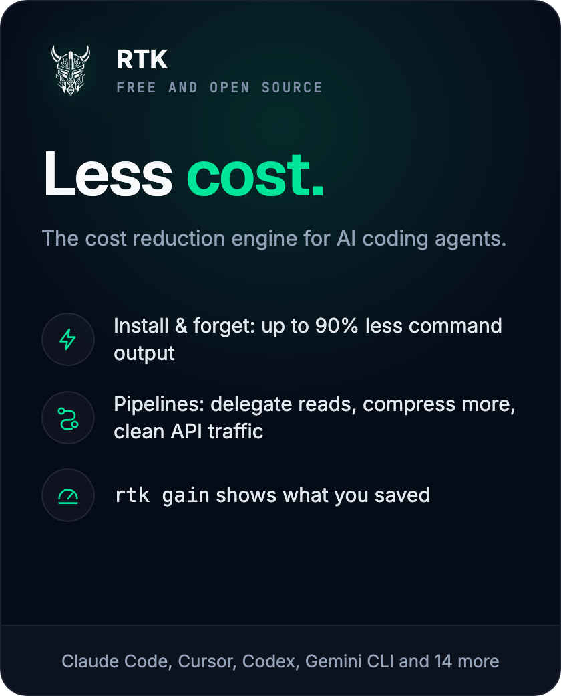
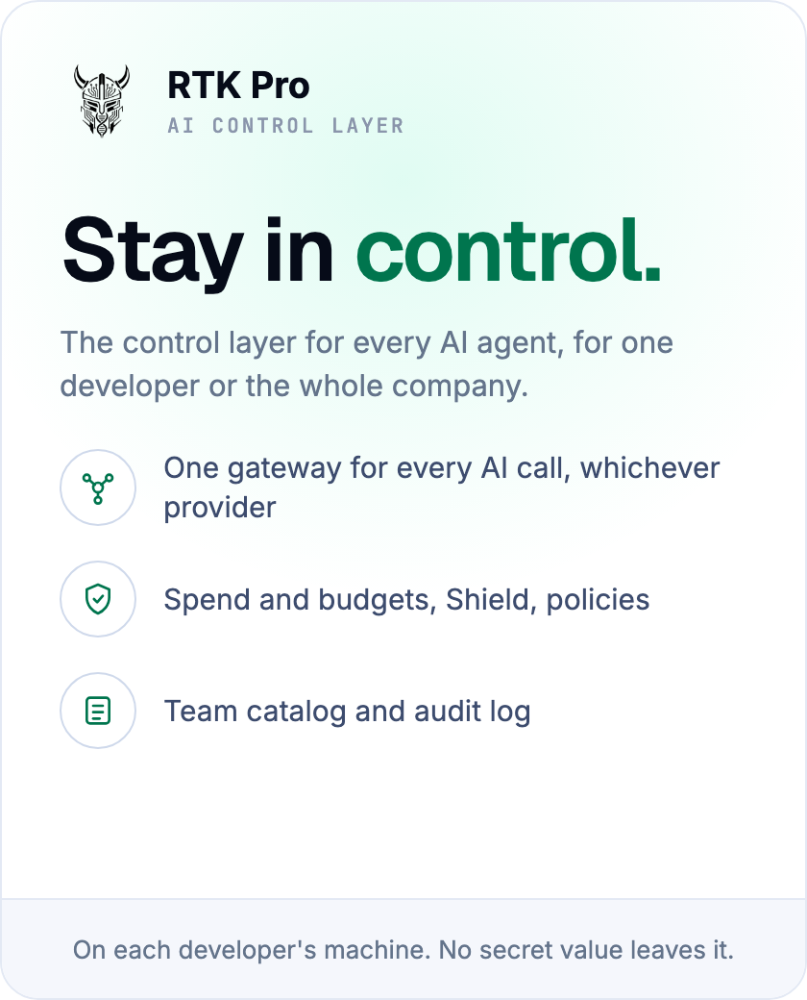
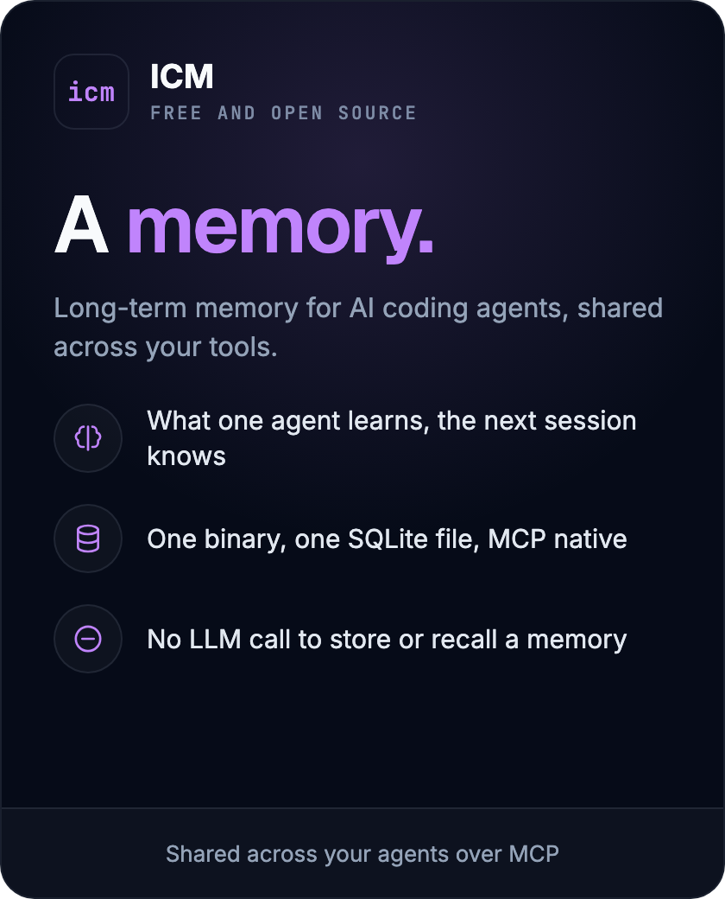

  

  <strong>RTK AI Labs builds AI tools to optimize usage and keep control.</strong>
   
  RTK cuts what your agents cost. RTK Pro keeps every agent under control. ICM gives them a memory.

  <a href="https://www.rtk-ai.app">Website</a> &bull;
  <a href="https://www.rtk-ai.app/docs/">Docs</a> &bull;
  <a href="https://www.rtk-ai.app/pipelines/">Pipelines</a> &bull;
  <a href="https://pro.rtk-ai.app">RTK Pro</a> &bull;
  <a href="https://github.com/rtk-ai/icm">ICM</a> &bull;
  <a href="https://discord.gg/RySmvNF5kF">Discord</a>

<table>
<tr>
<td width="33%"></td>
<td width="33%"></td>
<td width="33%"></td>
</tr>
<tr>
<td align="center"><a href="https://github.com/rtk-ai/rtk#install--forget">Install</a> &bull; <a href="https://www.rtk-ai.app/pipelines/">Pipelines</a> &bull; <a href="https://www.rtk-ai.app/docs/">Docs</a></td>
<td align="center"><a href="https://pro.rtk-ai.app">Discover RTK Pro</a> &bull; <a href="https://pro.rtk-ai.app/pricing">Plans</a> &bull; <a href="https://pro.rtk-ai.app/contact">Talk to us</a></td>
<td align="center"><a href="https://github.com/rtk-ai/icm">Repository</a> &bull; <a href="https://github.com/rtk-ai/icm/releases/latest">Releases</a></td>
</tr>
</table>

  Built in the open with 200+ contributors. <a href="https://github.com/rtk-ai/rtk/blob/master/CONTRIBUTING.md">Contributing</a> &bull; <a href="https://github.com/rtk-ai/rtk/blob/master/SECURITY.md">Security</a> &bull; <a href="mailto:contact@rtk-ai.app">contact@rtk-ai.app</a>

