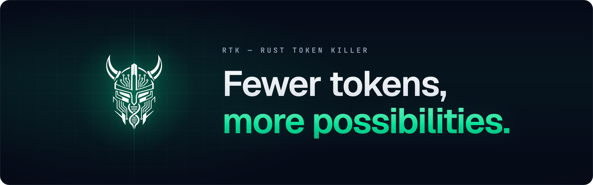
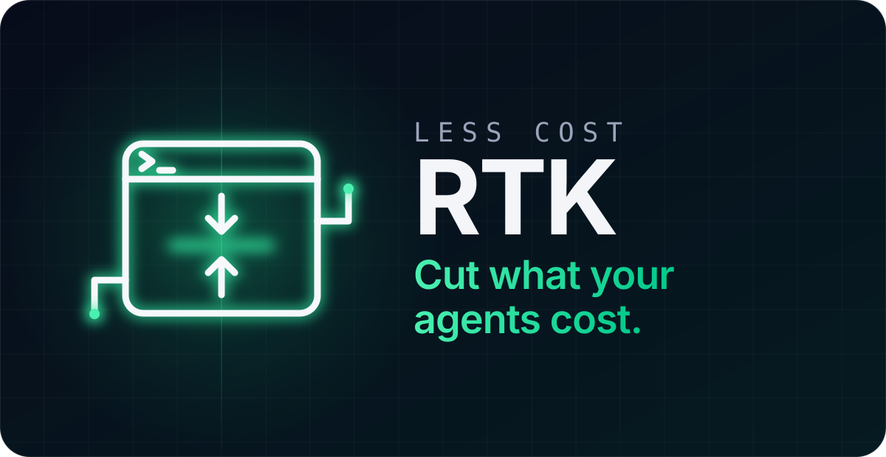
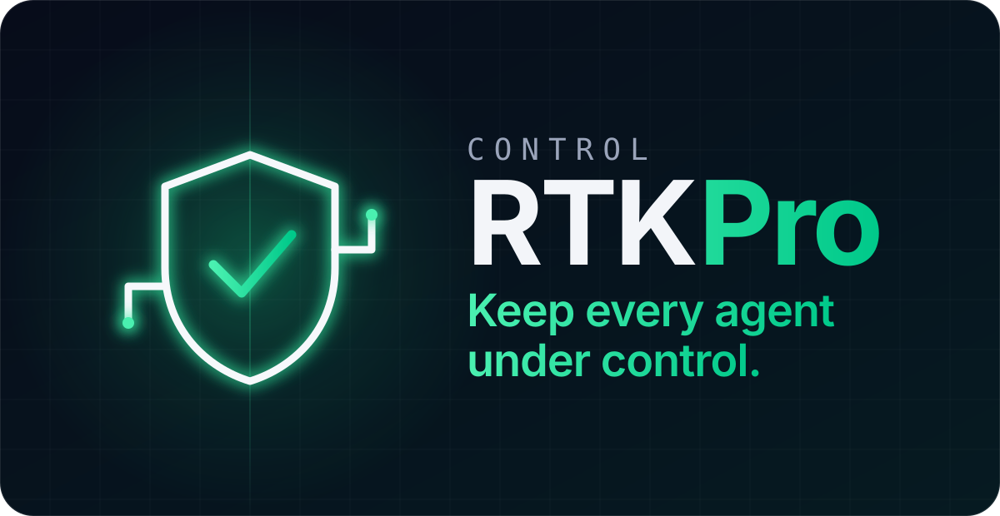
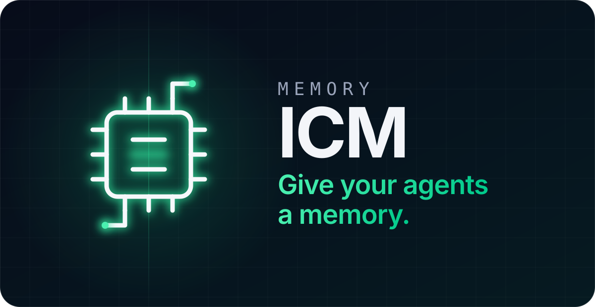

  

  <strong>RTK AI Labs builds AI tools to optimize usage and keep control.</strong>
   
  RTK cuts what your agents cost. RTK Pro keeps every agent under control. ICM gives them a memory.

  <a href="https://www.rtk-ai.app">Website</a> &bull;
  <a href="https://www.rtk-ai.app/docs/">Docs</a> &bull;
  <a href="https://www.rtk-ai.app/pipelines/">Pipelines</a> &bull;
  <a href="https://pro.rtk-ai.app">RTK Pro</a> &bull;
  <a href="https://github.com/rtk-ai/icm">ICM</a> &bull;
  <a href="https://discord.gg/RySmvNF5kF">Discord</a>

 

<table>
<tr valign="top">
<td width="33%">

  

<strong>The cost reduction engine for AI coding agents.</strong>

Install it and forget it: test runs, diffs, logs and builds are compressed before your agent reads them, and `rtk gain` shows what you saved.

- 100+ commands, up to 90% less command output
- Pipelines: hand heavy reads to a cheaper model, compress more than bash, clean the API traffic
- Claude Code, Cursor, Codex, Gemini CLI, Copilot and 13 more

Free and open source, built with 200+ contributors.

  <a href="https://github.com/rtk-ai/rtk#install--forget">Install RTK</a> &bull;
  <a href="https://www.rtk-ai.app/pipelines/">Pipelines</a> &bull;
  <a href="https://www.rtk-ai.app/docs/">Docs</a>

</td>
<td width="33%">

  

<strong>The control layer for every AI agent, for one developer or the whole company.</strong>

A company gateway every AI call goes through, whichever provider each team uses. It runs on each developer's machine; never a secret value leaves it.

- Spend by team, person and model, with budgets
- Secrets and personal data masked before any model sees them
- Risky commands stopped before they run
- A team catalog of skills, MCP servers and pipelines
- An audit log of who did what

A Dev plan for one developer. Teams, Business and Enterprise for companies, up to on-premise.

  <a href="https://pro.rtk-ai.app">Discover RTK Pro</a> &bull;
  <a href="https://pro.rtk-ai.app/pricing">Plans</a> &bull;
  <a href="https://pro.rtk-ai.app/contact">Talk to us</a>

</td>
<td width="33%">

  

<strong>Long-term memory for AI coding agents, shared across your tools.</strong>

What one agent learns on Monday, the next session knows on Tuesday, whichever tool it runs in.

- Decisions, fixes, conventions and preferences, kept across sessions
- One binary and one SQLite file, shared over MCP
- No LLM call to store or recall a memory

Free and open source.

  <a href="https://github.com/rtk-ai/icm">ICM</a> &bull;
  <a href="https://github.com/rtk-ai/icm/releases/latest">Releases</a>

</td>
</tr>
</table>

 

## Join in

Every RTK filter was written against real command output by a contributor, pipelines are shared the same way, and ICM is built in the open too. [Contributing](https://github.com/rtk-ai/rtk/blob/master/CONTRIBUTING.md) &bull; [Security](https://github.com/rtk-ai/rtk/blob/master/SECURITY.md) &bull; [Discord](https://discord.gg/RySmvNF5kF) &bull; contact@rtk-ai.app
